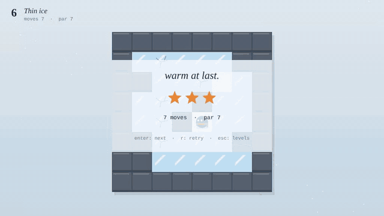

# Thaw

An ice-sliding puzzle game in twelve rooms, with a solver that proves every one of them.



You slide until something stops you. Ice keeps you going; snow, rock and crates stop you. Kick a crate and it slides by the same rules; slide one into water and it sinks and freezes into a snow tile you can stand on. Cracked ice breaks behind whatever leaves it. Reach the hut in as few moves as you can: par earns three stars.

Designed and built with AI assistance (Claude) to Vinícius Raposo's brief, then tested like production software.

**Project page:** [fishraposo.github.io/projects/thaw.html](https://fishraposo.github.io/projects/thaw.html)

**Play:** [in the browser](https://fishraposo.github.io/thaw/), or run it locally:

```bash
git clone https://github.com/FishRaposo/thaw.git
cd thaw
npm start            # serves the folder at http://localhost:8080
```

## Controls

| | Keyboard | Gamepad | Touch / mouse |
|---|---|---|---|
| Slide | arrows or WASD | d-pad | swipe |
| Undo | Z, U or Backspace | B | "undo" button |
| Restart | R | Y | "restart" button |
| Levels | Esc or L | Start | "levels" button |
| Confirm / next | Enter or Space | A | tap |
| Mute | M | | |

Moves pressed while you're still sliding are queued (up to three) and play in order, so you never lose a press.

## Under the hood

No engine, no dependencies, no asset files: about 1,200 lines of plain JavaScript on a 2D canvas, with synthesized sound.

- **Rules, session and screen are separate.**
  - `src/rules.js` is the game: pure functions over a small state.
  - `src/session.js` is everything between the rules and the screen: levels, undo, restart, stars, progress, and pacing input against the slide animation. Time is passed in, so a whole play session can be driven in a test.
  - `src/main.js` and `src/render.js` only animate and draw what the rules decided.
- **A breadth-first solver** (`src/solver.js`) searches game states. Every move costs one, so the first solution it finds is a shortest one. The hardest level explores 156 states.
- **The levels are tested, not trusted.** Every run of `npm test` re-solves all twelve levels and fails if any stated par isn't the true shortest solution. It replays each solution through the rules and checks that every level with crates actually needs them.
- **Where the levels came from.** Level 1 was built by hand. The rest were found by a solver-driven search (`scripts/search.mjs`) that proposes random rooms and keeps only those whose shortest solution is long enough and uses the mechanic being introduced. They were then picked and ordered by hand so each mechanic arrives alone before it's combined with others.
- **The animation can never disagree with the rules.** Slides, kicks, cracks and sinks animate from the rules' events, with cracks timed to the moment the mover leaves the tile. When nothing is animating, the view snaps to the real state.

Design reasoning: [docs/DESIGN.md](docs/DESIGN.md).

## Task pack

[`tasks/`](tasks/README.md) holds three game-development tasks built on this game:

- **Undo doesn't fix the ice**: a planted state-copy bug.
- **Next level starts with a move already made**: a planted input-queue bug.
- **Hints**: a feature that puts the solver in the player's hands.

Each has a brief, acceptance criteria, a reference solution with root-cause notes and an automated check. `npm run tasks` proves every check fails on the starting state and passes on the solution, with the whole unit suite green.

## Tests

```bash
npm test         # 19 tests: all 12 levels solved at par, each rule, undo, input queue, stars
npm run check    # syntax check of every module
npm run tasks    # the task pack
```

`scripts/smoke.py` plays all twelve levels in a real browser through key presses (including presses queued mid-slide), tries a swipe, and fails on any console error.

## Project layout

```
src/rules.js     the rules: tiles, sliding, kicking, sinking, cracking (no DOM)
src/solver.js    breadth-first solver
src/levels.js    the twelve rooms and their pars
src/session.js   levels, undo, restart, stars, input queue (no DOM)
src/render.js    drawing
src/main.js      input, animation, screens
src/audio.js     synthesized sound effects
scripts/         level search, smoke test, media recording
test/            node:test suites
tasks/           the task pack and its verifier
```

## Limitations

- Twelve rooms. The search tool can propose more, but each one is picked by hand.
- Tested in Chromium. Firefox and Safari use only standard canvas and WebAudio APIs but haven't been verified.

## License

[MIT](LICENSE)
